<div align="center">
  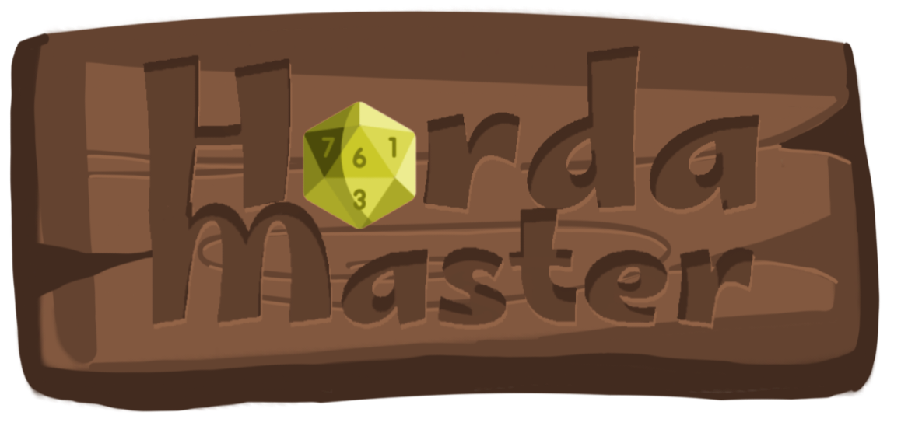

  <h3>Controle de combate para mestres de RPG de mesa, com interface ilustrada à mão.</h3>

  <p>
    <a href="https://maisepmaya.github.io/front-end-avancado-pucrio/"><strong>▶ Testar a demo ao vivo</strong></a>
    &nbsp;·&nbsp;
    <a href="#-decisões-de-design">Decisões de design</a>
    &nbsp;·&nbsp;
    <a href="#-identidade-visual">Identidade visual</a>
    &nbsp;·&nbsp;
    <a href="#-grid-proporção-e-responsividade">Grid e responsividade</a>
    &nbsp;·&nbsp;
    <a href="#-como-rodar">Como rodar</a>
  </p>

  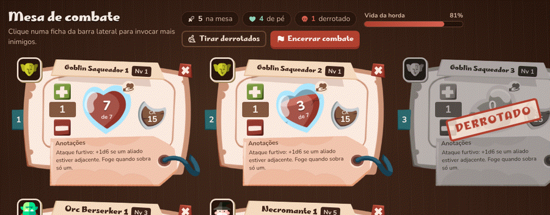
</div>

---

## 🎲 Em 30 segundos

|                  |                                                                                          |
| ---------------- | ---------------------------------------------------------------------------------------- |
| **O que é**      | Uma web app para o mestre de RPG controlar vários inimigos ao mesmo tempo durante o combate. |
| **Meu papel**    | Projeto individual: product design, **todas as ilustrações da interface**, UI e desenvolvimento front-end. |
| **Contexto**     | Pós-graduação em Desenvolvimento Full-Stack — PUC-Rio (2025). Redesenhado em 2026 para portfólio. |
| **Ferramentas**  | Ilustração digital · React · TypeScript · Tailwind CSS                               |
| **Destaques**    | Pergaminho que se desenrola · prévia ao vivo do cartão · feedback visual de dano/cura · bestiário D&D com rolagem infinita · funciona do celular ao desktop |

> Todas as artes da interface — madeira, pergaminhos, cartões, corações, escudo, estandarte, logo e o d20 — foram desenhadas por mim. Só os ícones das criaturas vêm do [Freepik](https://www.freepik.com).

---

## 🧩 O problema

Num RPG de mesa, o **mestre** narra a história e controla tudo que os jogadores enfrentam. Num combate contra uma horda — seis goblins, um orc e um necromante — ele precisa saber, a cada turno, **quem é quem, quanto de vida cada um ainda tem e quem já caiu**. Na prática isso vira papel rabiscado, planilha improvisada e conta de cabeça, bem no momento em que a mesa mais precisa de ritmo.

**Para quem:** mestres que preparam inimigos antes da sessão e precisam consultá-los e alterá-los rápido durante o jogo, muitas vezes num notebook ou celular ao lado do livro de regras.

**O que o produto precisa fazer bem:**

1. **Preparar** inimigos uma vez e reaproveitar (uma ficha → várias cópias).
2. **Distinguir** cópias iguais na hora (Goblin 1, Goblin 2, Goblin 3...).
3. **Atualizar** vida em um ou dois toques, sem perder a concentração na narrativa.
4. **Mostrar** o estado do combate de relance: quem está de pé e quem foi derrotado.

---

## ✨ Decisões de design

### 1. A ação principal não pode ficar escondida

Na primeira versão, o formulário de "Criar ficha" só aparecia quando o mouse passava por cima do pergaminho — bonito, mas a tarefa principal da tela ficava invisível e impossível de descobrir no celular.

**Agora:** mantive a metáfora, mas resolvi o problema de descoberta. A tela abre com o pergaminho **enrolado e as instruções logo abaixo**, terminando num botão claro: **"Abrir pergaminho"** (clicar no próprio rolo também funciona). Ao abrir, o papel **se desenrola por cima das instruções**, com o rolo de baixo acompanhando a borda; ao fechar, ele se enrola de novo e as instruções reaparecem.

<div align="center">
  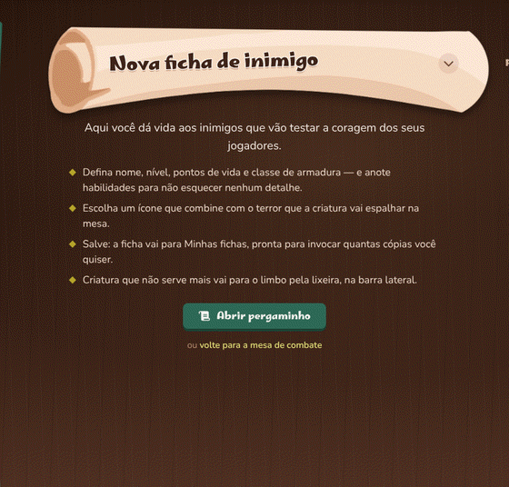
</div>

Do lado, uma **prévia ao vivo** mostra o cartão exatamente como ele vai aparecer na mesa. Os números ganharam botões de − / + (mais fáceis de usar no toque) e o seletor de ícone virou uma **grade visual** no lugar de uma lista de texto.

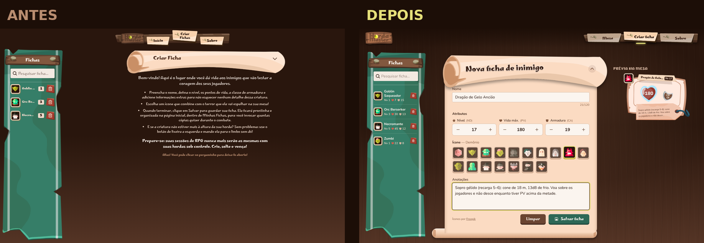

### 2. O estado do combate de relance

O grid de cartões mostrava cada inimigo, mas não o combate como um todo, e a única ação em lote era um "Resetar" solto no rodapé.

**Agora:** um cabeçalho resume **quantos estão na mesa, de pé e derrotados**, e uma barra de **vida da horda** mostra o quanto o combate já avançou. As ações em lote ganharam nomes que dizem o que fazem (**Tirar derrotados**, **Encerrar combate**) e pedem confirmação, com o foco começando em "Cancelar".

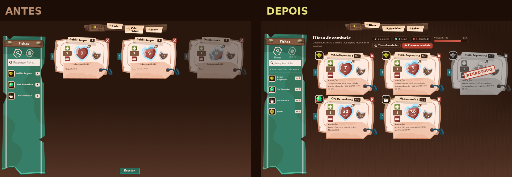

### 3. Cada cartão responde ao que acontece com ele

- O **coração muda de ilustração** conforme a vida: cheio → machucado → partido.
- Dano faz o coração **tremer**; cura faz ele **pulsar**.
- Ao chegar a 0 PV, o cartão perde a cor e recebe um **carimbo de "Derrotado"** — dá para ver quem caiu sem ler nenhum número.
- Os números ganharam contexto: **"7 de 7"** no coração, **"CA"** no escudo, **"Nv"** no nível e o ícone da criatura no canto, para diferenciar inimigos parecidos.

### 4. Estados vazios que ensinam

Mesa vazia não é mais "nada para mostrar": virou um mini-onboarding com os três passos de uso e um atalho para criar a primeira ficha. A barra lateral também orienta ("Clique numa ficha para invocar") e, sem fichas, oferece o botão de criar.

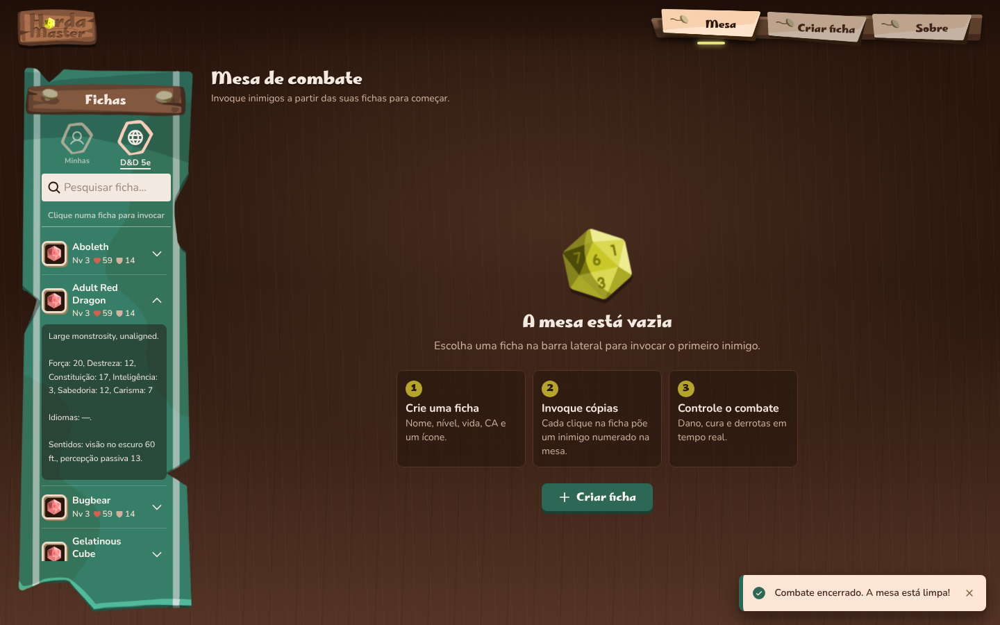

### 5. Feedback no lugar de `alert()`

Os alertas nativos do navegador quebravam a imersão. Agora há **avisos temáticos** (sucesso, informação, erro) — por exemplo, "Goblin Saqueador 4 entrou na mesa!" ao invocar um inimigo.

### 6. Acessibilidade e mobile

- Foco visível em todos os controles, navegação por teclado e `Esc` para fechar diálogos.
- Rótulos para leitores de tela em todos os botões de ícone; ilustrações decorativas marcadas como tal.
- Respeito a `prefers-reduced-motion`.
- No celular, a navegação vai para a parte de baixo (zona do polegar) e as fichas abrem numa gaveta lateral.

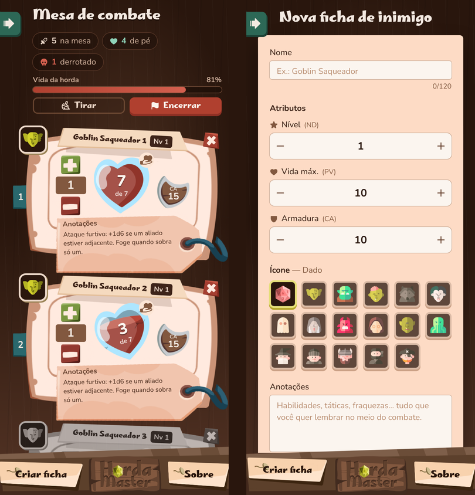

### 7. A ilustração define o encaixe, não o contrário

Como todas as artes são desenhadas à mão, o layout se adapta a elas — e não o contrário. Algumas decisões que saíram de **medir os próprios desenhos**:

- **Pergaminho:** a base do rolo é um arco (mais alta no meio), então o título fica no "corpo" do rolo, depois da espiral, e o papel começa escondido sob ele. Como num pergaminho de verdade, os dois rolos têm **a mesma largura, mas ficam deslocados**: o de cima começa junto com o papel e passa um pouco à direita; o de baixo termina junto com o papel, passa à esquerda e fica **atrás** dele — e o canto do papel acompanha a curva da ponta do rolo. O desenho nunca é esticado: deformar a espiral denunciava a "trapaça" na hora.
- **Estandarte das fichas:** as duas listras brancas do tecido ficam a 13% e 88% da largura do desenho. Busca, lista e detalhes ficam **entre as listras**, com divisórias finas em vez de caixas, e a barra de rolagem é fina e clara como elas.
- **Navegação:** o logo fica sozinho à esquerda e as páginas viram **etiquetas de papel pregadas numa tábua**, todas do mesmo tamanho e alinhadas. A página ativa fica clara, levantada e com um marcador dourado; as outras, um pouco mais escuras e tortas, como papel pregado à mão.
- **Lista de fichas legível:** ícone, nome e um resumo com ícones (nível, ♥ vida, 🛡 armadura). Os detalhes abrem por um botão — sem a lista "pular" no hover — com o texto completo e rolagem própria. As pinturas do bestiário D&D preenchem a moldura como um retrato e **ampliam ao passar o mouse**; a lista carrega sozinha conforme rola (**rolagem infinita**, sem botão de "carregar mais").

<div align="center">
  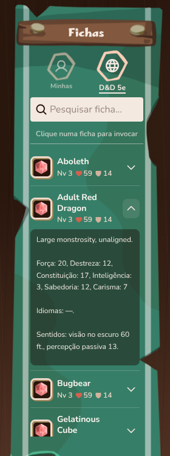
</div>

---

## 🎨 Identidade visual

O tom é de **mesa de taverna**: madeira, pergaminho e um estandarte de tecido, com contorno firme e volume simples — lúdico, mas legível no meio de uma sessão.

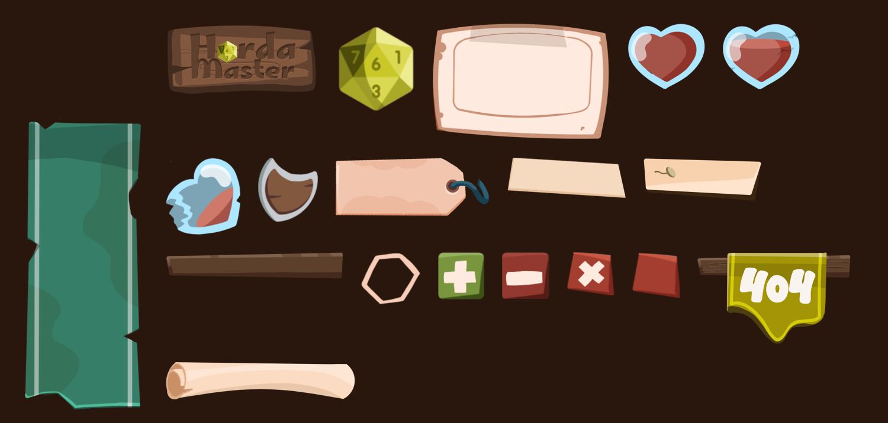

**Paleta** — tirada das próprias ilustrações:

| Madeira escura | Madeira | Pergaminho | Estandarte | Botão | d20 |
| :---: | :---: | :---: | :---: | :---: | :---: |
|  |  |  |  |  |  |
| `#29160d` | `#82583f` | `#fde6d6` | `#2d6856` | `#b0402f` | `#b5a52a` |

**Tipografia** — **Marhey** para títulos e botões (tem a cara de letreiro pintado) e **Nunito** para textos e números, que precisam ser lidos rápido.

**Componentes** — botões "de brinquedo" com sombra deslocada sem desfoque (o mesmo volume chapado das ilustrações), cartões de pergaminho com borda grossa e a ilustração usada como moldura do conteúdo (`ImgDiv`).

---

## 📐 Grid, proporção e responsividade

A interface segue um sistema de colunas por faixa de tela e o **grid de 8 pt** (Material Design): margens, alturas e espaçamentos são múltiplos de 8 e, no texto, de 4.

| Faixa | Largura | Colunas | Margem | Gutter | Navegação |
| --- | --- | :---: | :---: | :---: | --- |
| Celular | < 640 px | 4 | 16 px | 24 px | Abas na parte de baixo + fichas em gaveta |
| Tablet / notebook pequeno | 640–1279 px | 8 | 24 px | 24 px | Barra superior + fichas fixas na lateral |
| Desktop | ≥ 1280 px | 12 | 24 px | 24 px | Barra superior; conteúdo numa **área segura de 1200 px** |

- **Criar ficha** ocupa 8 das 12 colunas e a prévia, 4 (o pergaminho tem no máximo 760 px, para não dominar a tela). No tablet a prévia desce para baixo do formulário; no celular, tudo vira coluna única — e o título do pergaminho diminui junto com a tela para caber sempre numa linha só.
- **Mesa de combate** é uma área de trabalho, então usa a largura toda: os cartões se reorganizam sozinhos (1 a 4 por linha). Abaixo de 390 px o cartão inteiro encolhe na mesma proporção, em vez de ser cortado.
- **Alturas no grid de 8:** barras de 56/64 px, botões e campos de 48 px no toque e 40/32 px com mouse, barra lateral de 256 px.
- **Áreas de toque:** no celular, todo controle tem pelo menos 44–48 px. Dentro dos cartões, onde a ilustração define o tamanho, os botões ganharam uma área de toque invisível maior que o desenho.
- **"Onde estou? Para onde posso ir?"** (Krug): a página ativa tem o indicador de papel, cada tela tem seu título visível e o título da aba do navegador acompanha a página.
- **Sem rolagem horizontal** de 320 a 1920 px — verificado com um teste automatizado que percorre seis larguras de tela e mede os alvos de toque.

---

## 🖼️ Telas

| Mesa de combate | Criar ficha |
| :---: | :---: |
| 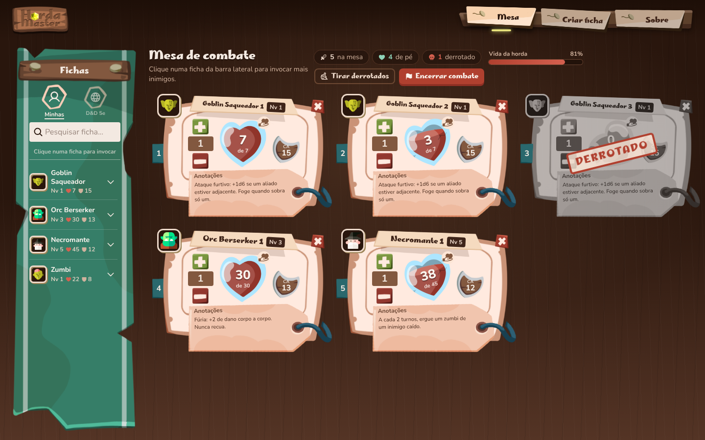 | 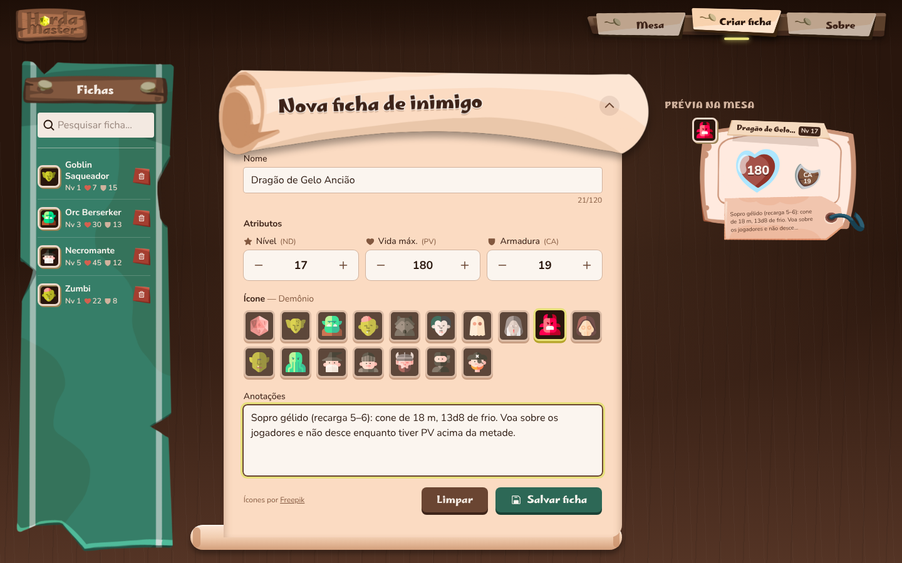 |
| **Sobre** | **Mesa vazia** |
| 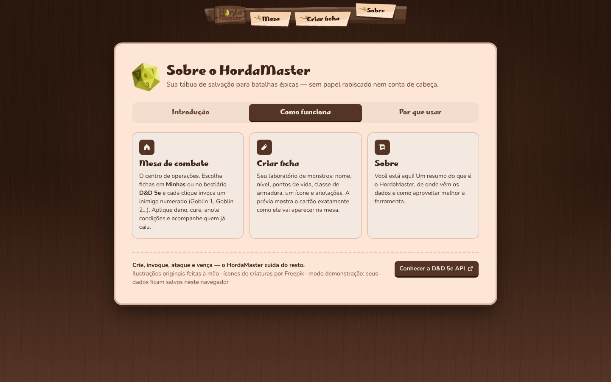 |  |

---

## ⚔️ Funcionalidades

- Criar e apagar fichas de inimigos (nome, nível, vida, CA, ícone e anotações).
- Buscar monstros prontos no bestiário oficial de D&D 5e ([5e SRD API](https://www.dnd5eapi.co/)), com rolagem infinita e ampliação da imagem ao passar o mouse.
- Invocar várias cópias numeradas automaticamente na mesa de combate.
- Aplicar dano e cura, editar a vida direto no coração e recuperar a vida total.
- Anotações por inimigo (condições, efeitos, lembretes).
- Resumo do combate, remover derrotados e encerrar combate.

---

## 🚀 Como rodar

### Modo demo (sem back-end)

Sem configuração nenhuma, o app roda em **modo demo**: os dados ficam no `localStorage` do navegador e já vêm alguns inimigos de exemplo. É o modo da [versão publicada](https://maisepmaya.github.io/front-end-avancado-pucrio/).

```bash
git clone https://github.com/maisepmaya/front-end-avancado-pucrio.git
cd front-end-avancado-pucrio
npm install
npm run dev
```

Acesse `http://localhost:5173`.

### Com o back-end (Flask + SQLite)

Suba a [HordaMaster API](https://github.com/maisepmaya/back-end-puc-rio-project/) e crie um arquivo `.env` (há um modelo em `.env.example`):

```bash
VITE_API_URL=http://localhost:5000
```

### Com Docker

```bash
docker build -t hordamaster .                                              # modo demo
docker build --build-arg VITE_API_URL=http://localhost:5000 -t hordamaster . # com back-end
docker run -p 3000:3000 hordamaster
```

A aplicação fica em `http://localhost:3000`.

### Publicação

Cada push na `main` publica o site no GitHub Pages pelo workflow em `.github/workflows/deploy.yml`.

---

## 🛠️ Por trás da interface

**Stack:** React 19 · TypeScript · Vite · Tailwind CSS 4 · React Router · Phosphor Icons

<div align="center">
  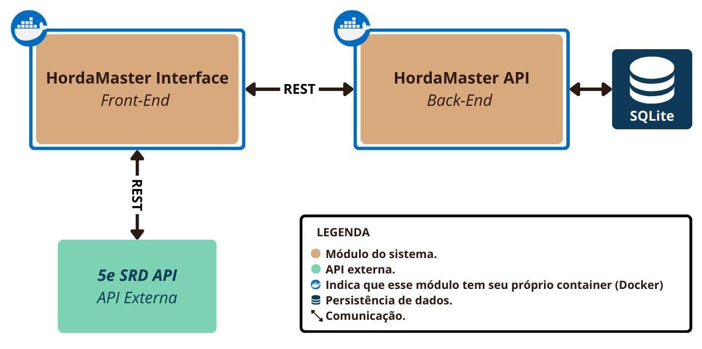
</div>

- **API interna** ([HordaMaster API](https://github.com/maisepmaya/back-end-puc-rio-project/)) — cria, lista e apaga fichas e cartões de combate.
- **API externa** ([5e SRD API](https://www.dnd5eapi.co/)) — monstros de D&D 5e. Licença MIT; dados sob Open Game License. Não exige chave de acesso.

| Método | Endpoint                     | Uso                          |
| ------ | ---------------------------- | ---------------------------- |
| `GET`  | `/api/monsters`              | Lista de monstros            |
| `GET`  | `/api/2014/monsters/{index}` | Detalhes de um monstro       |

---

## 🔭 Próximos passos

- **Ordem de iniciativa** — o pedido mais natural depois do controle de vida.
- **Condições com ícones** (envenenado, caído, atordoado) no lugar de texto livre.
- **Teste de usabilidade com mestres** durante uma sessão real, medindo o tempo para aplicar dano em um inimigo específico.

---

<div align="center">
  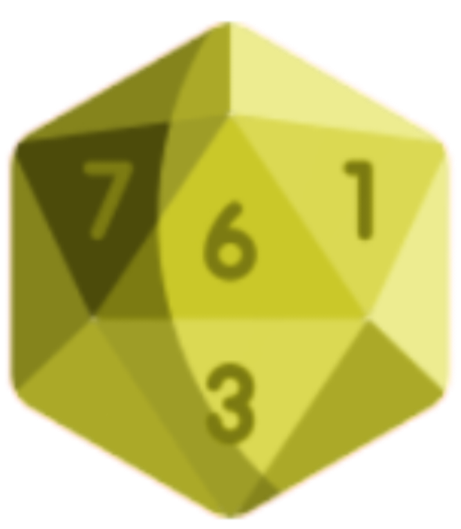
  <p>Ilustrações, UI e código por <a href="https://github.com/maisepmaya">@maisepmaya</a> · Ícones de criaturas por <a href="https://www.freepik.com">Freepik</a></p>
  <p><sub>Projeto da Pós-Graduação em Desenvolvimento Full-Stack — PUC-Rio</sub></p>
</div>
